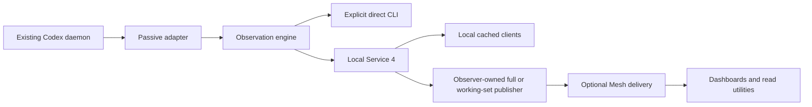

# Agent Observer architecture

Observer publishes read-only native state. Codex is the only implemented native
adapter; native provider tools own conversation control. The current prerelease
tuple is API 4, snapshot/watch 6 and Service 4. Working-set has independent
version-1 contracts. See [API reference](read-api.md).

## Components and read paths

| Component | Responsibility |
| --- | --- |
| Pure model and public read facade | Validate observations, select exact identities and expose uncertainty without native I/O |
| Passive Codex adapter | Query an existing authenticated owning daemon and normalize bounded metadata |
| Observation engine | Reconcile samples, retain uncertainty, expire evidence and plan bounded refreshes |
| Local service | Host the engine, isolate helpers and serve authenticated bounded cached reads/watches |
| Observer networking | Project native records and supply pure full/working-set profiles and cached publishers |
| Mesh Plus | Bind configured hosts/routes, transport cached publications and enforce delivery validity |
| Consumer | Choose presentation and utility policy, respect coverage/leases and revoke failed streams |

Core and local service import no Mesh. Mesh does not collect provider state.
Agent Plus is an independent native-TUI entry/window tool. Tmux Observer and
Tmux Plus serve separate generic tmux workflows.

## Identity and evidence

An exact identity is `hostScope/provider/namespace/nativeIdKind/nativeId`.
The namespace separates native homes. A thread-tree root, title, path, PID or
window is metadata, not a replacement row identity. A supplied host scope alone
does not authenticate a remote host; delivery binds it to the configured route.

Runtime, phase, activity, saved existence, classification and source coverage
are independent facts. Codex daemon `idle` is running/waiting. Parked requires
the reviewed positive native predicate, not missing loaded membership or a
closed terminal. Failed reads preserve bounded last-known evidence without
turning it into current state.

Each fact keeps its originating evidence clock and freshness. Receiving a copy,
refresh hint or heartbeat does not renew it. Native boottime values are not
comparable across hosts; Mesh exposes expiry in the receiving clock context.
The [boundary reference](observation.md) defines these rules.

## Supported delivery

- [Direct reads](../getting-started.md) explicitly query the local existing daemon.
- [Service 4](../guides/local-service.md) shares one independently hosted collector with local clients.
- [Working-set](../guides/working-set.md) projects active membership plus recent context with independent membership/scope leases.
- [Full Mesh reads](../guides/full-mesh-reads.md) retain fuller diagnostic inventories and their own publisher selection.

Read watches deliver sampled reconciled state. They do not promise every native
transition, durable event replay or per-turn completion delivery. Consumers
must recompute expiry during silence and revoke current facts at gaps or loss.

## Supported scope and acceptance

Claude observation, Observer writes and standalone active-only hosting are
retired. Shared projection helpers remain because working-set needs them.
Delta synchronization is deferred and dark; optional view-feed or prepared-read
adoption does not select an experimental transport automatically.

Source, public package, installed role, native runtime, consumer and physical
device acceptance are separate. [Operations](../maintenance/operations.md) points to exact
receipts and owner manifests; [validation](../maintenance/validation.md)+explains independent native proof.
